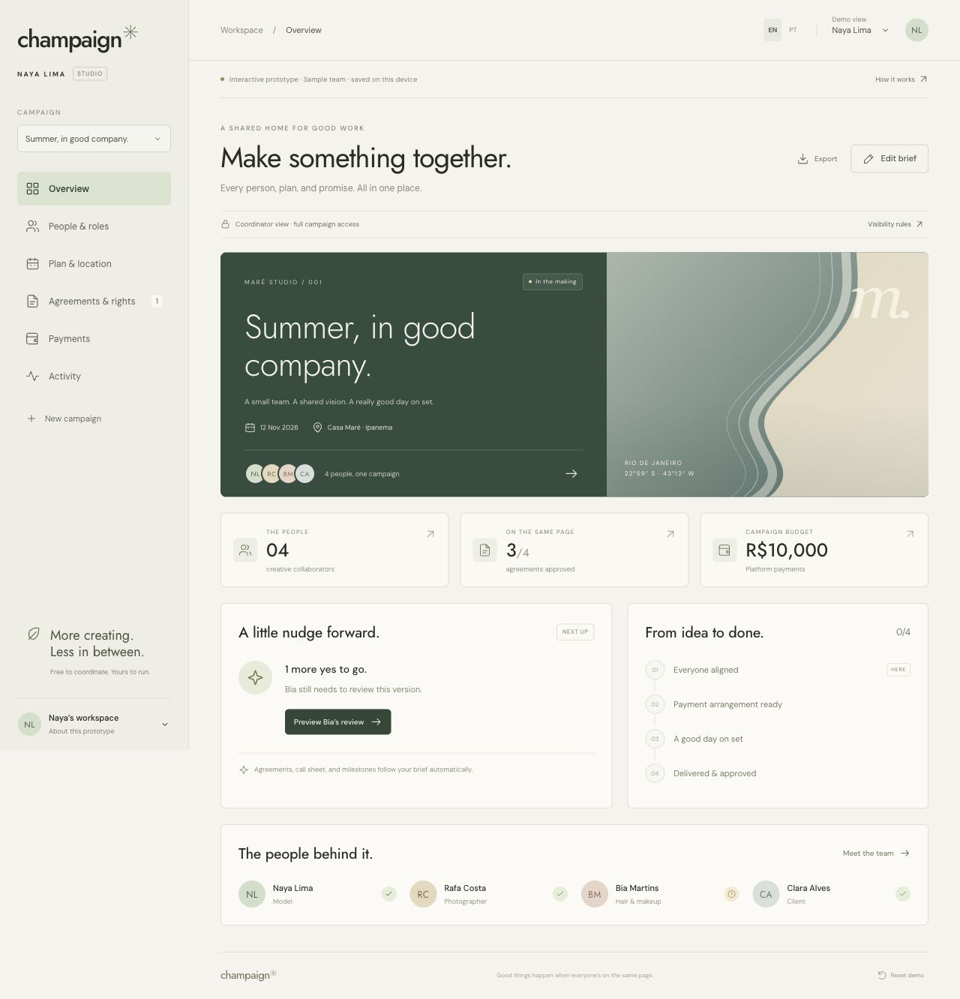

# Champaign ✳

**Every person, plan, and promise behind a creative campaign.**

An independent, open-source campaign coordination prototype for Naya Lima. Built with React, TypeScript, and Vite, using the ivory, ink, geometric typography, and quiet editorial spacing of Naya's portfolio.

[Open Naya's private preview](https://naya-campaign.vercel.app/) · [Visibility policy](src/permissions.ts) · [Website integration](docs/INTEGRATION.md)



## Try it

```sh
npm ci
npm run dev
```

Open the printed localhost URL (default `http://127.0.0.1:4327`). Node 22.20+ is recommended. `npm run build` produces a static `dist/` directory. Local Vite development runs the frontend directly. The hosted Vercel preview additionally uses the server-side password gate below.

## Private hosted preview

The shared password is provided separately by the workspace owner.

Vercel's root `middleware.ts` checks the shared preview session before serving HTML, JavaScript, CSS, or other assets. The login supports English and Portuguese. A successful password check issues a signed, host-only, HttpOnly, Secure cookie for seven days; **Lock preview** clears it. Incorrect credentials, expired/tampered cookies, cross-origin form submissions, and missing server configuration are rejected. Responses are private and uncached.

Configure `PREVIEW_PASSWORD_HASH` and `PREVIEW_SESSION_SECRET` as sensitive, server-only Vercel variables for production and preview. No `VITE_` variable contains a credential. After linking this checkout to the Champaign project, pipe the chosen password on stdin to `node scripts/configure-preview-env.mjs`; the helper generates the scrypt hash and a random signing key without writing credentials to disk or logging values. Existing variables are not silently overwritten. Redeploy after configuration or rotation.

The gate controls shared preview entry. It does not authenticate individual campaign participants or replace the future role-authorized backend. The source and fictional sample data remain open source.

## What works

- Campaign creation and switching, a shared brief, goals, date, location, team roles, and service fees.
- English and Brazilian Portuguese interface; editable campaign content remains as entered.
- Role-specific demo views, personal agreement drafts, explicit usage term/territory/channel limits, and AI-use restrictions.
- Visibility by authority: coordinator sees the full campaign; client sees its quote and shared work status; collaborators see only their own rates, milestones, and agreements. This also applies to generated documents, activity, and exports. Job titles do not automatically grant coordinator privileges.
- Material scope, crew, or time changes create a new revision and invalidate earlier approvals. Agreements and call sheets follow the current brief automatically.
- Coordinator-managed schedule, per-person demo check-in, shoot completion, participant handover, and separate client acceptance.
- A simulated funding and payout ledger with milestone gates and duplicate-payment prevention.
- Three arrangements: unpaid collaboration, paid outside the platform, and simulated platform payments. Coordination is free in all three.
- Illustrative 5% platform fee added once to the client bill, separate from participant service fees. Processing costs, taxes, insurance, expenses, and FX are not modeled.
- Activity history, browser-local persistence, current-campaign JSON export scoped to the active role, reset, and printable agreement/call-sheet previews (browser Print → Save as PDF).

The sample campaign uses a fictional brand and fictional collaborators alongside Naya. No relationship with a real client is implied. Coastal artwork is original SVG, not a photograph or synthetic likeness of Naya. Google Fonts is optional; local fallback fonts work if unavailable.

## Walk through the campaign

1. Open **Agreements & rights**, or choose **Preview Bia's review** from the overview. Read Bia's draft and approve it in the demo.
2. Use **Demo view** to switch back to Naya or to Clara (the client). On **Payments**, simulate client funding.
3. Switch between Naya, Rafa, and Bia. Each person confirms their own arrival on **Plan & location**.
4. As Naya, confirm the shoot is complete. Session installments become eligible for a simulated release by Naya or the client.
5. Each crew member submits a handover from **People & roles**. Clara approves each handover, then remaining payments can be simulated.
6. Before funding or check-in, edit the brief, change a call time, or add a collaborator. Observe that everyone needs to approve the new version. Once funded or started, changes are intentionally locked until a real amendment/refund process exists.
7. Create an unpaid campaign or externally paid job to try free coordination without platform funding.

## Prototype boundaries

**This is not a production booking or payment service.** Data lives in one browser's localStorage. Persona switching is a demonstration, not authentication or authorization. Other devices and people do not share the state. Browser-local history can be edited and is not an immutable audit trail. Exported JSON contains workspace details; do not put sensitive information here.

No messages or invitations are sent, identities checked, real attendance verified, contracts signed, funds held, or payments made. The payment display is a simulation, not escrow. There are no background agents or real AI calls: automation is deterministic and runs while the app is open.

Agreement drafts have unresolved real-world terms. Each starts with a draft notice, distinguishes image/performance/copyright permissions, and identifies matters needing legal review. Demo approval does not create an authenticated electronic signature. Requesting AI use does not grant a license.

## Validation

```sh
npm run check
npm test
npm run build
```

Thirty-two tests cover the preview gate plus approval invalidation, role restrictions, schedule revisions, funding and attendance prerequisites, duplicate releases, delivery/client approval, exact payout accounting, unpaid/external arrangements, private document access, payout activity, and export redaction. They validate the preview boundary and prototype policy, not real multi-user campaign isolation.

## Connecting to Naya's website

See [docs/INTEGRATION.md](docs/INTEGRATION.md). This repository remains independent from `naya-website`; the initial prototype does not change her live site or DNS.

## From prototype to service

The next production work is multi-user identity and tenant isolation, versioned server records and concurrency controls, real document review and signing, payments through a suitable provider, and moderation/safety processes. Exact milestone terms must vary by role; the common 50/50 split here is a demonstration. Real acceptance deadlines and dispute resolution must prevent indefinite client withholding.

No recurring or scheduled deployment workflows are configured. Existing Vercel plan usage applies; no additional paid service was configured. Consult [docs/HANDOFF.md](docs/HANDOFF.md) for the current verification and deployment state.

## License

MIT for the software and original SVG artwork. Open source applies to code, not private campaign information, personal identity, likeness rights, third-party photos, or trademarks. No Naya photography or private modeling contract is included.
